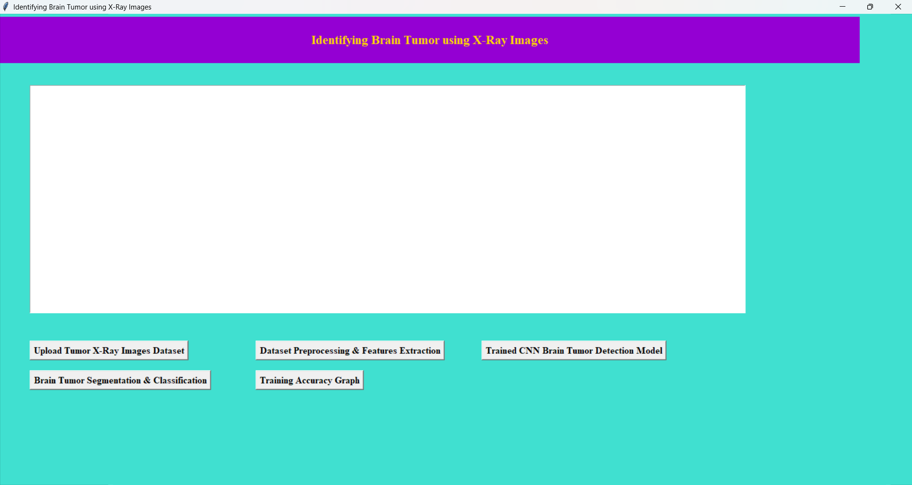
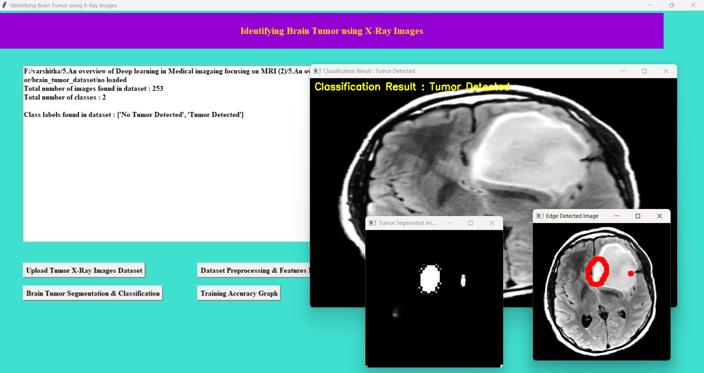
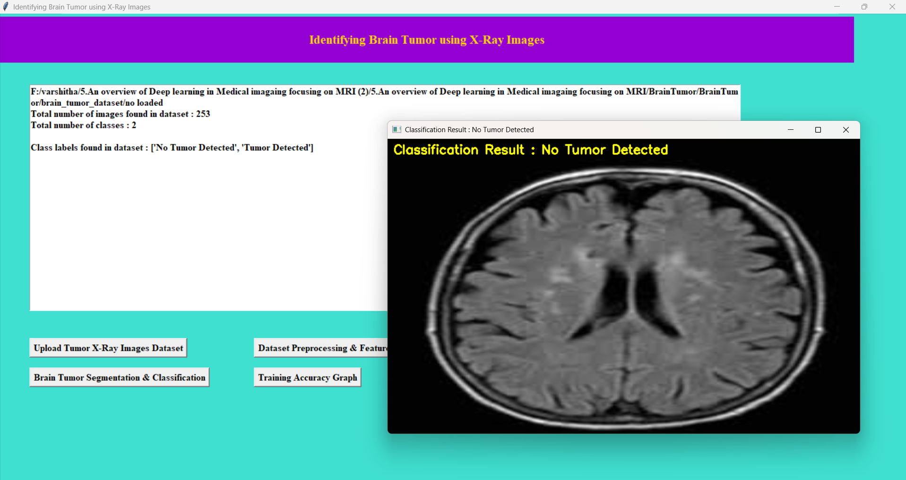
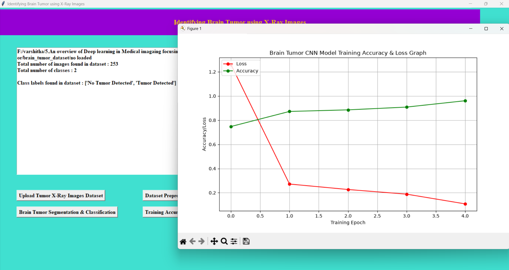

# 🧠 Brain Tumor Detection Using CNN

A deep learning project for brain image classification and tumor segmentation using Convolutional Neural Networks (CNNs).

## 📌 About the Project

Brain tumors require careful medical examination and analysis. This project explores the application of deep learning and image processing techniques to identify potential brain tumors from input images.

The system uses a trained CNN model to classify an input image and provides a segmentation output to help visualize the detected region. A graphical user interface allows users to interact with the application and view the results.

This project demonstrates how deep learning can be applied to medical image analysis as an educational and research-oriented application.

## ✨ Key Features

- **Image Classification:** Predicts whether an input image is classified as showing a tumor or no tumor by the trained model.
- **Tumor Segmentation:** Generates a segmentation output for visual analysis.
- **Graphical User Interface:** Provides an interface for selecting images and viewing results.
- **Image Processing:** Uses OpenCV for image-processing operations.
- **Deep Learning Model:** Uses trained CNN-related model files for prediction.
- **Result Visualization:** Displays the model's output for the selected image.

## 🛠️ Technologies Used

| Technology | Purpose |
|---|---|
| Python | Core programming language |
| TensorFlow | Deep learning framework |
| Keras | Model loading and neural network operations |
| OpenCV | Image processing and thresholding |
| NumPy | Numerical and array operations |
| CNN | Image classification |
| VS Code | Development environment |

## 📂 Project Structure

```text
BrainTumor/
├── BrainTumor.py
├── Model/
│   ├── model.json
│   ├── model_weights.h5
│   ├── segmented_model.json
│   ├── segmented_weights.h5
│   └── history.pckl
├── requirements.txt
├── run.bat
└── README.md
```

## ⚙️ Installation and Setup

### Prerequisites

- Python installed on your computer
- Git (optional, for cloning the repository)
- Required project files and model weights

### Step 1: Clone the Repository

```bash
git clone https://github.com/Varshithathandu21/Brain-Tumor-Detection-using-CNN.git
```

### Step 2: Open the Project Folder

```bash
cd Brain-Tumor-Detection-using-CNN
```

### Step 3: Create a Virtual Environment

```bash
python -m venv venv
```

Activate it on Windows:

```bash
venv\Scripts\activate
```

### Step 4: Install Dependencies

```bash
pip install -r requirements.txt
```

### Step 5: Run the Application

```bash
python BrainTumor.py
```

Alternatively, you can use `run.bat` if it is configured for your environment.

## 🖥️ Screenshots


### 1. Main Application Interface


### 2. Tumor Detected


### 3. No Tumor Detected


### 4. Model Accuracy and Loss Graph



## 🔬 How It Works

1. **Input Image:** The user selects an image through the graphical interface.
2. **Preprocessing:** The image is processed into a format suitable for the trained model.
3. **Classification:** The CNN model generates a prediction for the input image.
4. **Segmentation:** The segmentation model produces an output for visualizing the relevant region.
5. **Result Display:** The application displays the prediction and segmentation output.

## 🚀 Future Enhancements

- Improve model evaluation using appropriate performance metrics.
- Add support for additional image formats and robust input validation.
- Improve the visualization of segmentation results.
- Develop a more user-friendly interface.
- Evaluate the model on suitable, independently held-out datasets.

## ⚠️ Limitations

The output depends on the trained model, the quality of the input image, and the data used during training. Predictions may be incorrect, and segmentation outputs may not accurately represent tumor boundaries. Model performance should be evaluated using appropriate test data before making claims about accuracy.

## 📄 Disclaimer

**This project is intended for educational and research purposes only.** It is not a medical device and must not be used to diagnose, treat, or make clinical decisions about brain tumors. Medical images and predictions should be evaluated by qualified healthcare professionals.

## 👩‍💻 Author

**Varshitha Thandu**

GitHub: [Varshithathandu21](https://github.com/Varshithathandu21)
